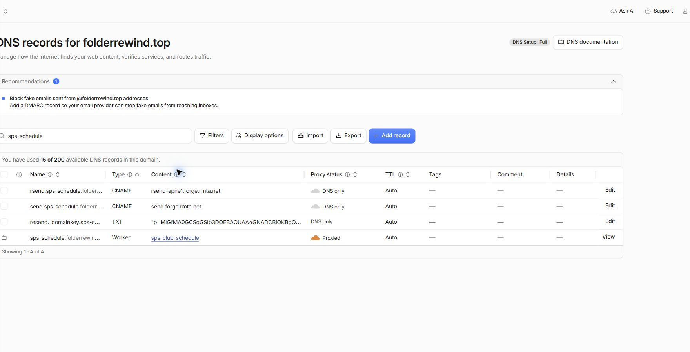

# SPS Resend DNS 配置回执

- 操作时间：2026-11-04 20:09–20:16（Asia/Shanghai，UTC+8）．
- Cloudflare 区域：`folderrewind.top`．
- 发信域名：`sps-schedule.folderrewind.top`．
- 预期发件人：`SPS 社团日程 <notifications@sps-schedule.folderrewind.top>`．
- 总体结果：**三条记录已新增并保存；权威 DNS 与 Cloudflare 公共 DNS 查询全部通过，域名管理员侧 DNS 工作完成．部分递归解析节点仍可能保留配置前的负缓存．**
- 操作方式：使用域名管理员已登录的 Microsoft Edge / Cloudflare 控制台．未创建或导出 API 凭据．

## 配置结果

| 名称 | 类型 | 本次操作 | 保存后值核对 | 公开 DNS 查询 |
| --- | --- | --- | --- | --- |
| `resend._domainkey.sps-schedule.folderrewind.top` | TXT | 新增 | 与原执行清单完整 DKIM 公钥一致，TTL Auto | 权威与 Cloudflare 公共 DNS 均通过；权威返回值按大小写精确比较一致 |
| `rsend.sps-schedule.folderrewind.top` | CNAME | 新增 | `rsend-apne1.forge.rmta.net`，DNS only，TTL Auto | 直接返回 `rsend-apne1.forge.rmta.net.`，通过 |
| `send.sps-schedule.folderrewind.top` | CNAME | 新增 | `send.forge.rmta.net`，DNS only，TTL Auto | 直接返回 `send.forge.rmta.net.`，通过 |

保存的 DKIM TXT 内容如下，为公开公钥，不含私钥或 API 密钥：

```text
p=MIGfMA0GCSqGSIb3DQEBAQUAA4GNADCBiQKBgQC/nHquffg1rzq2FvF1nODwk0pGAXKyhSLcCuIprqnQUb3n1Fmcm6xBKZn9cGIMM49/ukv+rM4nJOb9RQhPUeNgvfQ1WXGrUMquLFLU3nvHA+bWsYGosGnBominfQDxlyphSOcVxio9p6nYebG+vcB6M6BIZJAQyvcbPQkvZ7wgYQIDAQAB
```

写入前已查看该区域全部现有记录，三个目标名称均不存在，未发现同名冲突或影响目标名称的子域 NS 委派．写入后重新加载控制台，三条记录及实际值均可回读．控制台没有提供本次新记录的记录 ID，因此以完整名称、类型、实际值及截图追踪．

## 代理、Flatten 与现有 API

- 两条目标 CNAME 均为 DNS only / 灰云．
- 区域为 Free，DNS 设置页和记录表单没有可选的全区域／逐条 CNAME Flatten 开关；本次没有修改区域级设置．官方说明这两类可选 Flatten 功能适用于付费区域．权威 DNS 已直接返回两条 CNAME，确认本次目标记录没有被展平为 IP．[Cloudflare 官方说明](https://developers.cloudflare.com/dns/cname-flattening/set-up-cname-flattening/)
- 现有 `sps-schedule.folderrewind.top` 仍绑定 Worker `sps-club-schedule`，保持 Proxied、TTL Auto．
- 未修改 API 主机记录、Worker 自定义域名绑定、Worker 代码，以及根域名或其他子域的现有 MX/SPF/DMARC．未为本次发信启用收件服务．

| API 检查 | 时间（UTC+8） | 结果 |
| --- | --- | --- |
| 配置前 GET `/health` | 2026-11-04 20:09:35 | HTTP 200，`{"ok":true,"service":"sps-club-api"}` |
| 配置后 GET `/health` | 2026-11-04 20:15:05 | HTTP 200，`{"ok":true,"service":"sps-club-api"}` |

健康接口用于确认原 API 仍可达，不代表邮件发送或业务通知已通过验收．

## DNS 验证证据与缓存说明

- 公开 NS 查询返回实际权威服务器 `amit.ns.cloudflare.com` 和 `hope.ns.cloudflare.com`．
- 2026-11-04 20:16:08，直接向 `amit.ns.cloudflare.com` 查询三条记录，内容全部与执行清单匹配；DKIM 按大小写精确比较通过．
- 2026-11-04 20:16:10–20:16:13，经 `https://cloudflare-dns.com/dns-query` 公共解析接口查询，三项均为 `Status: 0`，内容正确．公开响应 TTL 为 300 秒；控制台设置仍为 Auto．
- Google Public DNS 在 20:15:06–20:15:09 已返回三条正确记录，但 20:15:42 的一次 TXT 复查仍返回 `Status: 3`（NXDOMAIN）．这说明递归解析结果尚未完全一致；权威记录和 Cloudflare 公共解析已验证正常，无需反复改写记录．若 Resend 暂时仍显示待验证，可等待旧缓存刷新后再次验证．
- 无配置冲突或未完成的域名侧写入项．未登录维护方的 Resend 账号，因此本回执不声称其域名已经显示 Verified．

配置截图仅保留本任务的记录列表及原 API 绑定，已避开账号邮箱和其他业务记录：



## 交接给网站维护方

域名管理员侧已完成约定的三条 DNS，请维护方继续：

1. 在创建发信域名的 Resend 账号／团队中打开 `sps-schedule.folderrewind.top`，执行域名验证并确认发信验证通过；区域应与原配置的 Tokyo / `ap-northeast-1` 一致．如当前 Records 页已与本回执不同，请提供更新后的记录要求，不必转发任何 API 密钥．
2. 创建专用发信密钥，在实际执行通知的业务后端（现有架构为原 `sps-club-api` Worker，或明确选定的通知服务）以 Secret 保存，并设置上述发件人．API 密钥无需交给域名管理员，不放入前端、仓库或 DNS 回执．
3. 完成社员邮箱绑定／验证和通知偏好、新任务触发、后台截止提醒、发送去重与失败重试，并部署．现有预约同步闹钟不能直接视为邮件提醒功能．
4. 分别验收新任务与截止提醒实际收信，包括关闭网页仍能收到提醒、重复执行不重复发送，以及完成／归档／关闭通知后按规则停止提醒．

本回执确认的是 DNS 已就绪．Resend Verified、API 发信成功和成员自动通知上线由维护方分别确认．本次未发送测试邮件，也未代替维护方部署通知代码．

### 可直接转发的交接文字

> 我这边已按你提供的清单，在 `folderrewind.top` 新增 DKIM TXT 和两条 CNAME．两个 CNAME 均为 DNS only、TTL Auto；控制台回读、权威 DNS 和 Cloudflare 公共 DNS 三项验证均通过，现有 API 健康检查前后都是 200．部分递归解析节点可能还保留旧的 NXDOMAIN 缓存．请你在自己的 Resend 账号验证 `sps-schedule.folderrewind.top`，再配置后端专用发信密钥并接入网站通知．完整记录和验证结果见本回执．
